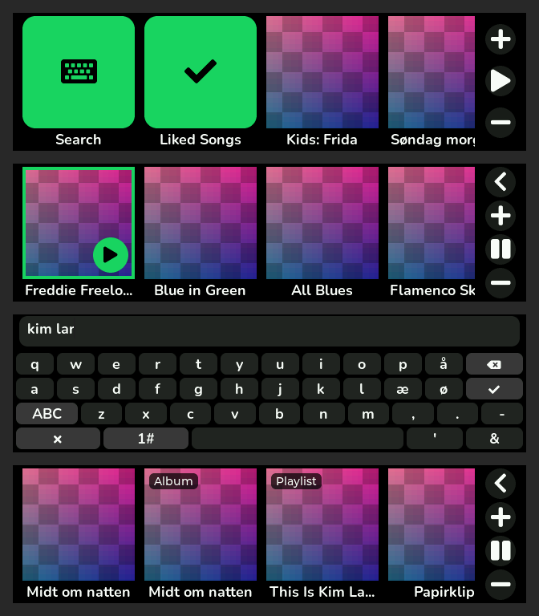
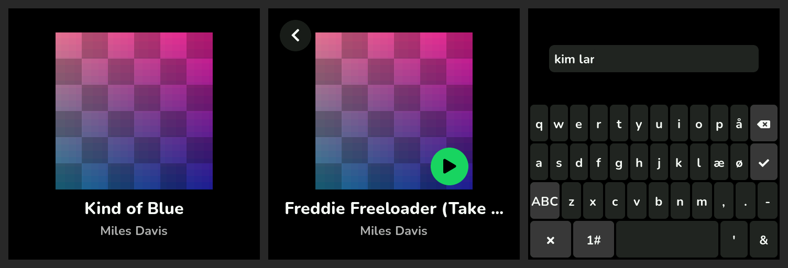

# Kids Player

A small touchscreen that plays Spotify on Sonos speakers, with the album cover for every song.

Grown-ups make playlists in Spotify. The player shows them as big covers. A tap plays the song on the
chosen Sonos room. There is no app to open and no server to run: the player is an ESP32-S3 board that
talks to Spotify's Web API for the lists and covers, and to the Sonos speakers directly on the home
network for playback.

**Install page:** <https://moalbaek.github.io/kids-player/> (one-click browser installer, setup steps)





*Screens rendered on a computer with the real UI code (placeholder covers).*

## Two modes

| | Kids mode | Whole library |
|---|---|---|
| Home screen | Playlists whose name starts with `Kids:` (prefix removed) | Search, Liked Songs, all playlists, saved albums |
| Default on | 2.16" cube | 3.49" strip |
| Volume cap | 40 % | 100 % |

Hold BOOT for 3 seconds and scan the QR code to change the mode, prefix or volume cap. The settings link
expires after five minutes. Tap **Done** on the player to close it early, or hold BOOT again for a fresh link.

## Hardware

| | Cube | Strip |
|---|---|---|
| Board | Waveshare ESP32-S3-Touch-AMOLED-2.16 | Waveshare ESP32-S3-Touch-LCD-3.49 (V2) |
| Screen | 480 × 480 AMOLED (CO5300), capacitive touch | 640 × 172 LCD (AXS15231B, used sideways), capacitive touch |
| Battery | LiPo via AXP2101 power chip (level shown on screen) | optional (level not shown) |
| Buttons | KEY3 = volume up, BOOT = volume down (hold: settings), PWR = pause/resume | BOOT = pause/resume (hold: settings), PWR = pause/resume (hold 2 s: power off) |

Both use the ESP32-S3R8 (8 MB PSRAM) with 16 MB flash.

## How it works

```
 phone ──scan QR──▶ player's web page ──▶ Spotify login (PKCE)
                                             │
                                             ▼
                               callback page on GitHub Pages
                               sends the code back to the player
                                             │
 player ◀──── playlists, songs, covers ──── Spotify Web API (HTTPS)
   │
   └──── UPnP/SOAP on port 1400 ───▶ Sonos (plays the Spotify playlist/album itself)
```

- **Spotify login** uses the authorization code flow with PKCE, so there is no client secret anywhere.
  Spotify only allows HTTPS redirect addresses, so `docs/callback.html` (on GitHub Pages) relays the code
  to the player at `http://<player-ip>/callback`. It only forwards to private IPv4 addresses.
- **Playback** goes straight to Sonos: the player clears the room's queue, adds the Spotify playlist or
  album as one container, jumps to the tapped song and presses play. Sonos streams from Spotify with its
  own linked account. Liked Songs have no container, so those songs are queued one by one.
- **Covers** are downloaded as 300 px JPEGs, decoded on the device and cached in PSRAM.
- **Updates** are published on GitHub Pages (`docs/fw/<board>/`). Players check at start-up and daily
  while the screen is off. A new version that never gets online is rolled back at the next restart.
  Automatic checks reinstall a rolled-back version up to two times, in case the player was switched off too early.
  Failed downloads leave those retries available. **Check for updates** on the settings page can still retry it.

## Spotify app settings

Create an app at <https://developer.spotify.com/dashboard> with:

- Redirect URI: `https://moalbaek.github.io/kids-player/callback.html`
- API: Web API

Put its Client ID in `firmware/main/config.h`. In Development Mode, Spotify allows up to 5 accounts
(add them under User Management) and the owner needs Premium.

Limits that shape the design (Spotify's February 2026 changes):

- Songs can only be listed for playlists the user owns or collaborates on. Followed playlists are still
  shown and play from the start.
- Search returns at most 10 results per type.
- Login tokens expire after about six months; the player then shows the login QR code again.

## Repository

```
docs/                 GitHub Pages: install page, login relay, firmware files
  callback.html       Spotify login relay
  flash/              browser installer images and manifests (ESP Web Tools)
  fw/<board>/         over-the-air update image + version.json
firmware/             ESP-IDF project
  main/               app (see below)
  test/               host unit tests for the pure parsing code
  sim/                desktop renderer that draws the real UI to PNG files
  release.sh          build both boards and publish into docs/
```

Main modules: `app_main.c` (state machine, owns all network calls), `ui.c` (LVGL screens),
`spotify.c` / `spotify_parse.c` (Web API), `sonos.c` / `sonos_proto.c` (UPnP), `images.c` (cover
download and cache), `web.c` (settings page, captive portal, login), `wifi.c`, `ota.c`, `settings.c`
(NVS), `board_cube.c` / `board_strip.c` (display, touch, buttons, battery).

## Building

Needs [ESP-IDF](https://docs.espressif.com/projects/esp-idf/) v5.5.

```sh
. $HOME/esp/esp-idf/export.sh
cd firmware
idf.py -B build_cube  -D SDKCONFIG=build_cube/sdkconfig  -D SDKCONFIG_DEFAULTS="sdkconfig.defaults;sdkconfig.defaults.cube"  build
idf.py -B build_strip -D SDKCONFIG=build_strip/sdkconfig -D SDKCONFIG_DEFAULTS="sdkconfig.defaults;sdkconfig.defaults.strip" build
idf.py -B build_cube -p /dev/ttyACM0 flash monitor     # flash over USB
```

Tests and screen renders:

```sh
sh firmware/test/run.sh          # parsing and protocol tests (gcc, ASan/UBSan)
make -C firmware/sim             # PNGs of every screen for both boards in firmware/sim/out/
```

Releasing: bump `PROJECT_VER` in `firmware/CMakeLists.txt`, run `firmware/release.sh`, commit `docs/`
and push. Players pick the new version up over Wi-Fi.

## Status

The firmware builds for both boards and the parsing and protocol code is unit-tested. Playing a Spotify
playlist container on Sonos was confirmed on a real system. Not yet tried on the actual boards: touch
orientation on the strip, button placement on the cube, album and Liked Songs playback.
